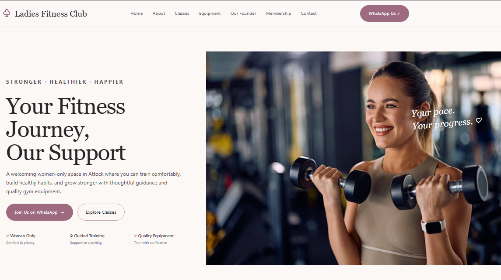

# Ladies Fitness Club Website 🌸

A responsive website built for Ladies Fitness Club, a women's fitness centre based in Attock, Pakistan.

## 🌐 Live Demo

[Visit the live website](https://ladiesfitnessclub-attock.netlify.app/)

## ✨ Features

- Clean, modern blush-pink design
- Responsive layout for desktop and mobile
- Fitness services and facilities information
- Business details and owner introduction
- WhatsApp integration for customer enquiries

## 🛠️ Technologies

- HTML
- CSS

## 📌 About the Project

This project was created to give a local fitness business a welcoming online presence and make information about its services and contact options easier to access.

Building this website helped me gain practical experience in web development, website design, and deployment.

## 🚀 Run Locally

1. Download or clone this repository.
2. Open `index.html` in your web browser.

## 👩‍💻 Developer

**DuaDevv**

[GitHub Profile](https://github.com/DuaDevv)
